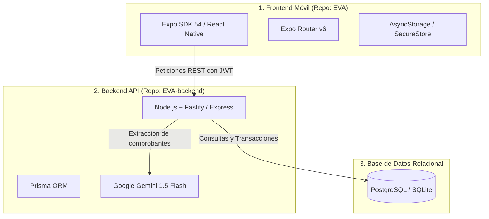
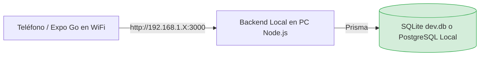
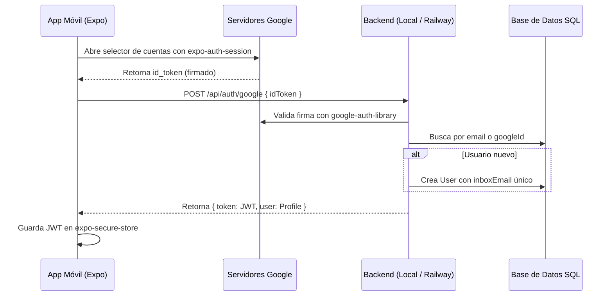
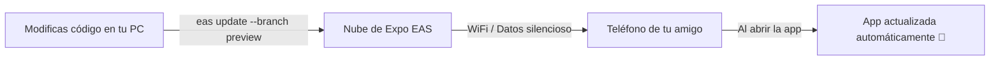

# EVA — Estrategia SQL, Arquitectura Backend y Roadmap v1

> Documento oficial de arquitectura y decisiones de diseño acordadas para la versión 1.0 (v1) de EVA.
> Define la transición desde Firebase hacia una arquitectura desacoplada con Backend propio, base de datos SQL, automatización de gastos mediante buzón inteligente y un flujo de desarrollo local a **costo $0.00** hasta el lanzamiento.

---

## 1. Visión y Decisiones de Arquitectura

### 1.1 Por qué migrar de Firebase a SQL
Los datos financieros personales y compartidos (cuentas, transacciones, presupuestos, suscripciones y deudas entre personas) son **estrictamente relacionales**.
- **Integridad referencial y transacciones ACID**: Una transferencia entre dos cuentas o la amortización de una deuda no puede quedar a medias; o se registra completa en ambas cuentas o se revierte.
- **Consultas financieras optimizadas**: Cálculos como balances mensuales, gastos por categoría o deudas acumuladas se resuelven con agregaciones estándar en SQL (`SUM`, `GROUP BY`), evitando las lecturas complejas y costosas de subcolecciones en NoSQL.

### 1.2 Separación en 2 Repositorios
La arquitectura se divide de forma limpia en dos proyectos independientes:



* **Repositorio Frontend (`EVA`)**: Tu proyecto móvil actual en Expo SDK 54. Contiene pantallas, componentes, navegación y diseño. **No se despliega en Railway**; se compila como APK para Android y se actualiza mediante Expo EAS.
* **Repositorio Backend (`EVA-backend`)**: Proyecto nuevo con Node.js, TypeScript y Prisma ORM. Es el cerebro que valida la autenticación, ejecuta transacciones SQL y protege secretos (claves de IA). Se alojará en **Railway** al lanzar la v1.

---

## 2. Estrategia de Trabajo en Local (Costo $0.00 hasta la v1)

Para no incurrir en gastos de servidor ($5/mes de Railway) mientras la app está en desarrollo, todo el trabajo se realiza en tu propia computadora:



### 2.1 Mocks en Frontend (`EXPO_PUBLIC_USE_MOCKS`)
Para diseñar pantallas sin depender de tener el backend encendido ni conexión a internet:
- Se mantiene el archivo de datos de prueba `src/data/mock/mockData.ts`.
- En el archivo `.env` del frontend:
  ```env
  EXPO_PUBLIC_USE_MOCKS=true
  EXPO_PUBLIC_API_URL=http://localhost:3000
  ```
- Cuando `EXPO_PUBLIC_USE_MOCKS="true"`, los servicios leen del mock instantáneamente.

### 2.2 Base de Datos Local con SQLite en Prisma
Cuando programes el Backend en tu PC:
- En `schema.prisma` se inicia con:
  ```prisma
  datasource db {
    provider = "sqlite"
    url      = "file:./dev.db"
  }
  ```
- **Ventaja**: No requiere instalar servidores de bases de datos. Todo vive en un archivo `dev.db` en tu máquina.
- **Migración a Railway en el futuro**: Solo se cambia `provider = "sqlite"` por `provider = "postgresql"` y la URL por la de Railway. Todo el código de TypeScript se mantiene 100% idéntico.

---

## 3. Autenticación: Google Sign-In + SQL + JWT

El botón de Google maquetado en `LoginScreen.tsx` se conecta de forma segura:



- **Almacenamiento seguro**: El token JWT de sesión se guarda en el chip criptográfico del teléfono mediante `expo-secure-store` (reemplazando `AsyncStorage` para credenciales).
- **Vinculación de cuentas**: Si el usuario se registró primero con correo/contraseña y luego usa Google con el mismo email, el backend vincula ambas formas de acceso sin duplicar al usuario.

---

## 4. Automatización de Gastos: El Buzón Personalizado de EVA

Para resolver la fricción de ingresar gastos manuales sin enfrentar las restricciones de privacidad de Google (auditoría CASA de $15k para leer Gmail) ni las notificaciones bloqueadas en la pantalla de bloqueo de Android:

### 4.1 Dirección Inmutable por Cuenta (`inboxEmail`)
Al registrarse, el sistema genera automáticamente una dirección única e irrepetible:
$$\text{Formato: } \texttt{gastos.\{nombre\}-\{hash3\}@eva.com}$$
* *Ejemplo*: Para José, se genera `gastos.jose-a23@eva.com`.
* **Inmutabilidad**: Si el usuario cambia su nombre de pantalla a "Pepe" o "Robert", su dirección `gastos.jose-a23@eva.com` **nunca cambia**. Su regla de reenvío en Outlook o Gmail seguirá funcionando para siempre.
* **Cero colisiones**: Gracias a los 3 caracteres alfanuméricos ($36^3 = 46,656$ combinaciones por cada nombre), dos usuarios con el mismo nombre jamás chocarán.

### 4.2 Enrutamiento Gratuito y Filtro de Publicidad
- **Recepción**: Se utiliza un enrutador gratuito (como Cloudflare Email Routing o Resend Inbound) con regla *Catch-All* que reenvía el correo entrante al endpoint de Webhook de tu backend.
- **Filtro contra promociones comerciales**:
  1. *Filtro de correo del usuario*: La regla en Outlook/Gmail solo reenvía correos cuyo asunto incluya palabras clave (`Enviaste`, `yaparon`, `Constancia`, `Transferencia`).
  2. *Filtro de IA en el Backend*: Gemini analiza el contenido; si determina que es publicidad o boletín comercial, responde `es_transaccion: false` y el backend lo destruye silenciosamente en milisegundos.

### 4.3 La "Bandeja de Aprobación" (UX de Control)
Los movimientos capturados nunca se insertan directamente en el saldo de la cuenta:
1. Se guardan en la tabla `PendingTransaction` con estado `PENDIENTE`.
2. En el Dashboard de EVA se muestra la tarjeta de pendientes:
   > 🔔 **Tienes 2 movimientos detectados:**
   > * Yape a *Chifa Central*: **- S/ 28.50** (Hoy 1:45 PM)
   > * Transferencia de *Carlos M.*: **+ S/ 50.00** (Hoy 11:20 AM)
3. El usuario desliza para aceptar o descartar con un solo toque.

### 4.4 Manual Interactivo en la App (Cero muros de texto)
Se implementa una pantalla interactiva (`src/screens/profile/EmailAutomationGuideScreen.tsx`):
- Pestañas claras: `[ Gmail ]` y `[ Outlook / Hotmail ]`.
- Botón háptico de 1 toque: `[ 📋 Copiar mi correo EVA ]`.
- Enlace directo al navegador: `[ ↗ Abrir configuración de filtros ]`.
- 3 pasos visuales con capturas ilustradas.
- Indicador en vivo de "Esperando tu primer correo de prueba..." con animación de éxito.

---

## 5. Actualizaciones Automáticas Over-The-Air (EAS Update)

Para enviar actualizaciones y correcciones a tus amigos sin que tengan que descargar un nuevo APK:



1. **Instalación Inicial (v1)**:
   - Se compila el `.apk` instalable con `eas build --platform android --profile preview`.
   - Se comparte el archivo con amigos para que lo instalen una sola vez.
2. **Actualizaciones Posteriores**:
   - Cada cambio en TypeScript, pantallas, estilos o correcciones se despliega ejecutando:
     ```bash
     eas update --branch preview --message "Corrección de interfaz y nuevo filtro"
     ```
   - Al abrir la app, `expo-updates` descarga el bundle en segundo plano y se actualiza sola.

---

## 6. Nuevas Funcionalidades Acordadas para la v1

| Funcionalidad | Descripción | Tecnología |
|---|---|---|
| **Modo Privacidad en Público** | Difumina u oculta todos los saldos visibles (`S/ ••••••`) activable mediante un botón de **ojito 👁️** en cabecera o **agitando el teléfono**. | Sensor acelerómetro (`expo-sensors`) + blur/máscara visual. |
| **Seguridad Biométrica** | Bloqueo al abrir la app con desbloqueo inmediato por huella dactilar o Face ID. | `expo-local-authentication`. |
| **Asesor de Tarjeta de Crédito** | Indica qué tarjeta conviene usar hoy según su fecha de corte para aprovechar hasta 50 días de financiamiento libre de intereses. | Lógica matemática sobre `dia_corte` y `dia_pago`. |
| **Auditoría de Gastos Hormiga** | Micro-reporte mensual inteligente que suma micropagos menores a S/ 15 en Yape/comida y muestra su impacto porcentual. | Prompt analítico en Gemini 1.5 Flash. |
| *Exclusiones temporales* | Multi-moneda y cobro por QR quedan descartados para la v1 para mantener el foco en la velocidad de entrega. | — |

---

## 7. Esquema Relacional de Base de Datos (Prisma)

Estructura de tablas para el backend (`schema.prisma`):

```prisma
datasource db {
  provider = "sqlite" // Cambiar a "postgresql" al desplegar en Railway
  url      = env("DATABASE_URL")
}

generator client {
  provider = "prisma-client-js"
}

model User {
  id           String               @id @default(uuid())
  email        String               @unique
  nombre       String
  passwordHash String?              // Null si usa solo Google
  googleId     String?              @unique
  inboxEmail   String               @unique // "gastos.nombre-hash@eva.com"
  moneda       String               @default("PEN")
  createdAt    DateTime             @default(now())
  updatedAt    DateTime             @updatedAt

  accounts     Account[]
  categories   Category[]
  transactions Transaction[]
  pendientes   PendingTransaction[]
  services     Service[]
  contacts     Contact[]
}

model Account {
  id           String        @id @default(uuid())
  userId       String
  user         User          @relation(fields: [userId], references: [id], onDelete: Cascade)
  nombre       String
  tipo         String        // "debito", "credito", "efectivo", "billetera_digital"
  saldoActual  Decimal       @default(0.00)
  color        String
  icono        String
  diaCorte     Int?
  diaPago      Int?
  transactions Transaction[]
  createdAt    DateTime      @default(now())
}

model Category {
  id                 String        @id @default(uuid())
  userId             String
  user               User          @relation(fields: [userId], references: [id], onDelete: Cascade)
  nombre             String
  icono              String
  color              String
  presupuestoMensual Decimal?
  transactions       Transaction[]
}

model Transaction {
  id          String   @id @default(uuid())
  userId      String
  user        User     @relation(fields: [userId], references: [id], onDelete: Cascade)
  accountId   String
  account     Account  @relation(fields: [accountId], references: [id])
  categoryId  String?
  category    Category? @relation(fields: [categoryId], references: [id])
  monto       Decimal
  tipo        String   // "ingreso", "egreso", "transferencia"
  descripcion String
  fecha       DateTime
  createdAt   DateTime @default(now())
}

model PendingTransaction {
  id                String   @id @default(uuid())
  userId            String
  user              User     @relation(fields: [userId], references: [id], onDelete: Cascade)
  monto             Decimal
  tipo              String   // "ingreso" o "egreso"
  destinatario      String
  billeteraBanco    String   // "Yape", "Plin", "BCP", etc.
  categoriaSugerida String?
  estado            String   @default("PENDIENTE") // "PENDIENTE", "APROBADO", "DESCARTADO"
  createdAt         DateTime @default(now())
}

model Service {
  id               String           @id @default(uuid())
  userId           String
  user             User             @relation(fields: [userId], references: [id], onDelete: Cascade)
  nombre           String           // "Netflix", "Luz", etc.
  costoTotalActual Decimal
  diaCobro         Int
  frecuencia       String           // "mensual", "anual"
  subscribers      ServiceSubscriber[]
  createdAt        DateTime         @default(now())
}

model ServiceSubscriber {
  id         String   @id @default(uuid())
  serviceId  String
  service    Service  @relation(fields: [serviceId], references: [id], onDelete: Cascade)
  contactId  String?
  contact    Contact? @relation(fields: [contactId], references: [id])
  nombre     String
  cuotaFija  Decimal
  activo     Boolean  @default(true)
}

model Contact {
  id          String              @id @default(uuid())
  userId      String
  user        User                @relation(fields: [userId], references: [id], onDelete: Cascade)
  nombre      String
  telefono    String?
  subscribers ServiceSubscriber[]
  createdAt   DateTime            @default(now())
}
```

---

## 8. Hoja de Ruta Inmediata (Próximos Pasos)

### Fase 1: Limpieza del Frontend Móvil
1. Desinstalar `firebase` de `package.json` y eliminar `src/api/firebase.ts`.
2. Crear la pantalla del botón `+` en `app/(main)/add.tsx` para registro manual de transacciones.
3. Implementar el **Modo Privacidad** (botón de ojito 👁️ y detección de agitar con acelerómetro).
4. Implementar el desbloqueo con **Biometría** (`expo-local-authentication`).

### Fase 2: Backend Local (Costo $0.00)
1. Crear el repositorio independiente `EVA-backend` en la máquina local.
2. Configurar Prisma con SQLite (`dev.db`).
3. Crear el script `seed.ts` con los datos de prueba de `mockData.ts`.
4. Implementar endpoints de autenticación y transacciones.

### Fase 3: Conexión y Automatización
1. Conectar los servicios de Expo al backend local mediante la variable `EXPO_PUBLIC_API_URL`.
2. Diseñar la pantalla de guía interactiva de reenvío de correos (`EmailAutomationGuideScreen`).
3. Integrar Gemini para el procesamiento de comprobantes en el backend.

### Fase 4: Lanzamiento v1 en Railway y EAS Update
1. Cambiar el proveedor de base de datos de SQLite a PostgreSQL y desplegar en Railway ($5/mes).
2. Generar el APK preview con `eas build`.
3. Activar `eas update` para actualizaciones automáticas a los amigos que prueben la v1.
